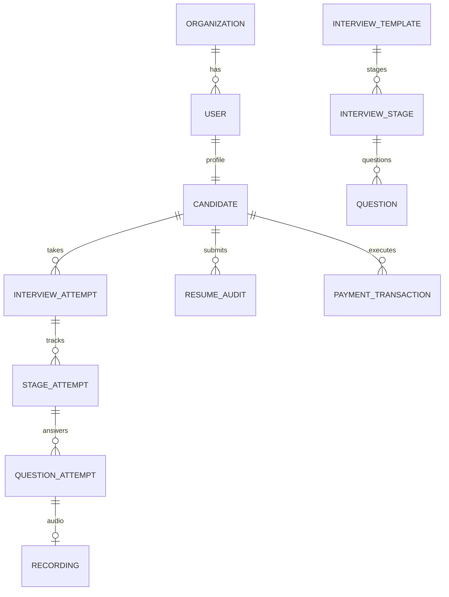

# 🏛️ CloudOps AI 3.0 — Enterprise Software Architecture & Technical Design Document

> **Platform:** CloudOps AI 3.0 — Voice Interview & Career Operating System  
> **Author:** Antigravity Senior Software & Cloud Architect  
> **Status:** Production-Ready Architectural Audit & Blueprint  
> **Version:** 3.0.0  
> **Last Updated:** October 2026  

---

## 📑 Table of Contents
1. [Executive Architecture Summary](#1-executive-architecture-summary)
2. [Component Inventory & Implementation Audit](#2-component-inventory--implementation-audit)
3. [End-to-End System Architecture (HLD & LLD)](#3-end-to-end-system-architecture-hld--lld)
4. [Deep-Dive Request & Data Flows](#4-deep-dive-request--data-flows)
   - 4.1 Normal User API Request
   - 4.2 Authentication & Session Lifecycle
   - 4.3 Database Connection Pool & Query Lifecycle
   - 4.4 AI Voice Interview & 5-Pillar Rubric Scoring
   - 4.5 Resume Parsing & TF-IDF ATS Matching
   - 4.6 Background Retention & Scheduled Cleanup
   - 4.7 CI/CD & Rolling Blue-Green Deployment
5. [AWS Cloud Production Blueprint](#5-aws-cloud-production-blueprint)
6. [Security, Network Boundaries & Threat Modeling](#6-security-network-boundaries--threat-modeling)
7. [Database Schema & Entity Relationship Architecture](#7-database-schema--entity-relationship-architecture)
8. [Architecture Explained in Simple Hinglish (Technical Walkthrough)](#8-architecture-explained-in-simple-hinglish-technical-walkthrough)
9. [Failure Modes & High-Traffic Bottleneck Analysis](#9-failure-modes--high-traffic-bottleneck-analysis)
10. [Prioritized Production-Readiness & Security Hardening Checklist](#10-prioritized-production-readiness--security-hardening-checklist)
11. [Glossary of Core Engineering Concepts](#11-glossary-of-core-engineering-concepts)
12. [Index of Architecture Source Files](#12-index-of-architecture-source-files)

---

## 1. Executive Architecture Summary

**CloudOps AI 3.0** is an enterprise-grade AI assessment and recruitment platform designed to evaluate Cloud, DevOps, and Site Reliability Engineers through real-time voice interviews, multi-cloud incident troubleshooting, and ATS resume auditing.

### Architectural Core Characteristics:
- **Decoupled Modern Web Architecture:** Frontend built with **Next.js 14 (App Router)** and Backend built with **FastAPI (Python 3.11/3.12)**.
- **Asynchronous Non-Blocking I/O:** Backend runs on `asyncio` using **Async SQLAlchemy 2.0** paired with the `asyncpg` PostgreSQL driver.
- **Pluggable AI & Multimodal Engine:** Abstract Base Classes (`AIProvider`, `SpeechToTextProvider`, `StorageProvider`) allow seamless swapping between cloud APIs (OpenAI GPT-4o-mini, Cloudinary, AWS S3) and self-hosted open-source models (`faster-whisper`, Ollama Llama3, Local Storage).
- **Gamified Real-Time Feedback:** 5-pillar rubric evaluation (Technical Accuracy, Concept Coverage, Reasoning Quality, Practical Knowledge, Communication Clarity) calculated alongside real-time speech telemetry (Words Per Minute, filler words count, pacing).

---

## 2. Component Inventory & Implementation Audit

Every component listed below has been verified against the physical codebase in `d:\AI_Interview3.0`.

| # | Component Name | Technology / Framework | Physical File Path | Purpose | Inputs & Outputs | Dependencies | Status in Code |
|---|---|---|---|---|---|---|---|
| **1** | **Frontend Core** | Next.js 14.2.5, React 18, TypeScript | `frontend/app/` | UI rendering, SSR, routing, and user interface | Input: User actions / Mic audio<br/>Output: HTML/DOM & REST API calls | Zustand, Tailwind, Lucide, Recharts | **Implemented** |
| **2** | **Client State Store** | Zustand 4.5.4 | `frontend/lib/store.ts` | Global auth state, session management, and profile synchronization | Input: User profile & token<br/>Output: Reactive state & localStorage | `localStorage`, `sessionStorage` | **Implemented** |
| **3** | **API Fetch Client** | Fetch API + Exponential Backoff | `frontend/lib/api.ts` | Centralized API client with JWT injection, cold-start retries, Render fallback | Input: Endpoint, body, options<br/>Output: JSON parsed response | Browser Fetch, `localStorage` | **Implemented** |
| **4** | **Audio Capture** | MediaRecorder Web API | `frontend/lib/media-recorder.ts` | Browser mic audio stream recording in WebM format | Input: Microphone stream<br/>Output: Audio `Blob` | Web Audio API | **Implemented** |
| **5** | **Backend Core Kernel** | FastAPI 0.110+, Uvicorn 0.28+ | `backend/app/main.py` | Main ASGI application, CORS, middleware, lifecycle hooks | Input: HTTP/HTTPS requests<br/>Output: JSON responses | Uvicorn, Gunicorn, Starlette | **Implemented** |
| **6** | **Telemetry Middleware** | Custom ASGI Middleware | `backend/app/core/telemetry_logger.py` | Measures execution time, adds `X-Process-Time`, writes structured logs | Input: HTTP Request/Response<br/>Output: `api_performance.log` | `time.perf_counter`, JSON | **Implemented** |
| **7** | **Security & Auth Core** | PyJWT / python-jose, bcrypt | `backend/app/core/security.py` | Password hashing, JWT token creation/verification, session revocation | Input: Passwords, tokens, claims<br/>Output: Hash strings, decoded claims | `bcrypt`, `python-jose`, `firebase-admin` | **Implemented** |
| **8** | **Database Engine** | SQLAlchemy 2.0 Async, asyncpg | `backend/app/core/database.py` | Connection pooling (`pool_size=20`), session generator (`get_db`) | Input: SQL Queries<br/>Output: Model objects / DB records | `asyncpg`, `aiosqlite`, PostgreSQL | **Implemented** |
| **9** | **Data Models (ORM)** | SQLAlchemy Declarative Models | `backend/app/models/*.py` | 24 Relational entity definitions (Users, Candidates, Attempts, Questions) | Input: Domain data<br/>Output: DB tables & foreign keys | SQLAlchemy Core, UUID4 | **Implemented** |
| **10** | **Admin In-Memory Cache** | SimpleTTLCache | `backend/app/core/admin_cache.py` | In-memory 60s TTL cache for heavy admin overview metrics | Input: Metric keys<br/>Output: Cached metrics dict | In-memory Python Dict | **Implemented** |
| **11** | **Evaluation Service** | Domain Service + Multi-Provider AI | `backend/app/services/evaluation_service.py` | 5-pillar rubric evaluation, audio transcription, XP awards | Input: Question attempt ID, audio/transcript<br/>Output: `QuestionEvaluationResult` | `OpenAIProvider`, `faster-whisper` | **Implemented** |
| **12** | **Resume ATS Service** | PyPDF, python-docx, Scikit-learn | `backend/app/services/resume_service.py` | Resume parsing, TF-IDF cosine similarity, STAR bullet rewriter | Input: Resume PDF/DOCX bytes + JD<br/>Output: ATS score, missing skills | `pypdf`, `python-docx`, `scikit-learn` | **Implemented** |
| **13** | **TF-IDF Matcher** | Scikit-learn TfidfVectorizer | `backend/app/services/tfidf_matcher.py` | Mathematical keyword & n-gram vector similarity matching | Input: Cleaned JD text & Resume text<br/>Output: Match %, skill overlap list | `scikit-learn`, `numpy` | **Implemented** |
| **14** | **Speech-to-Text Provider** | faster-whisper / Whisper | `backend/app/speech/whisper_provider.py` | Audio speech transcription with language detection & confidence | Input: Audio file path (.webm/.wav)<br/>Output: Transcript text, duration | `faster-whisper`, `ffmpeg` | **Implemented** |
| **15** | **Cloudinary Provider** | Cloudinary Python SDK | `backend/app/storage/cloudinary_provider.py` | Cloud storage for audio recordings & PDF resumes | Input: File bytes, filename, mime_type<br/>Output: `secure_url`, `public_id` | `cloudinary` library | **Implemented** |
| **16** | **Retention Scheduler** | APScheduler (AsyncIOScheduler) | `backend/app/main.py` | Periodic background job (every 24h) purging recordings older than 90 days | Input: Cron interval (24h)<br/>Output: Purged DB rows & deleted files | `apscheduler`, `RetentionService` | **Implemented** |
| **17** | **WhatsApp Notification** | AiSensy / Meta Cloud API | `backend/app/services/sms_service.py` | OTP verification codes and candidate alerts dispatch | Input: Phone number, OTP code<br/>Output: HTTP dispatch status | `httpx` async client | **Implemented** |
| **18** | **Email Notification** | SMTPLib (Gmail SMTP) | `backend/app/services/email_service.py` | Transactional email dispatch for OTP verification | Input: Email address, OTP code<br/>Output: SMTP delivery status | Python `smtplib`, `email.mime` | **Implemented** |
| **19** | **AWS S3 Storage Provider** | Proposed native AWS storage | `backend/app/storage/s3_provider.py` (Proposed) | Direct AWS S3 storage replacement for Cloudinary | Input: File bytes<br/>Output: S3 URL & Object Key | `boto3` / `aioboto3` | **PROPOSED** |
| **20** | **Redis Distributed Cache** | Proposed distributed cache | N/A (Currently local in-memory dict) | Shared cache across multiple container tasks for admin metrics & rate limiting | Input: Cache keys<br/>Output: Cached objects | `redis-py` / `aioredis` | **PROPOSED** |

---

## 3. End-to-End System Architecture (HLD & LLD)

### 3.1 High-Level Architecture (HLD)
The platform is organized into 6 clearly bounded logical layers:
1. **Client & Presentation Layer:** Browser interface with Next.js 14 and Web MediaRecorder for speech capture.
2. **Edge, DNS & Gateway Layer:** Route 53 DNS, CloudFront CDN / Vercel Edge, Application Load Balancer with ACM TLS termination.
3. **Application Server Layer:** FastAPI running on Uvicorn ASGI with Gunicorn worker process supervision.
4. **Data Persistence & Storage Layer:** PostgreSQL 16 relational database, S3 / Cloudinary object storage, and in-memory TTL caching.
5. **AI & Speech Engine:** OpenAI GPT-4o-mini / Ollama Llama3, faster-whisper, and Scikit-learn TF-IDF engine.
6. **Notification & External Gateways:** AiSensy WhatsApp API, Meta Cloud WhatsApp, and SMTP Email.

> 📁 *Detailed diagram source:* [01-high-level-architecture.mmd](file:///d:/AI_Interview3.0/docs/architecture/01-high-level-architecture.mmd)

### 3.2 Low-Level Architecture (LLD)
Inside the FastAPI backend, each incoming request traverses:
- **FastAPI Lifespan:** Boots the database connection pool (`AsyncSessionLocal`) and starts `AsyncIOScheduler` for retention cleanup.
- **Middleware Chain:** 
  1. `CORSMiddleware`: Validates `Origin` against allowed regex (Vercel, Render, Ngrok, localhost).
  2. `add_performance_telemetry_middleware`: Computes elapsed time via `time.perf_counter()`, attaches `X-Process-Time` header, and appends telemetry to `logs/api_performance.log`.
  3. `Global Exception Handler`: Formats unhandled exceptions into structured JSON (`StandardResponse`).
- **Dependency Injection Pipeline:** Resolves `get_db` (scoped `AsyncSession`) and `verify_auth_token` (JWT validation & session revocation check).
- **Domain Services:** Encapsulates business logic away from routers (`EvaluationService`, `ResumeService`, `CandidateService`).
- **Persistence Layer:** Queries executed via SQLAlchemy 2.0 Async ORM with automatic commit/rollback semantics.

> 📁 *Detailed diagram source:* [02-low-level-architecture.mmd](file:///d:/AI_Interview3.0/docs/architecture/02-low-level-architecture.mmd)

---

## 4. Deep-Dive Request & Data Flows

### 4.1 Normal User API Request Flow
```
User Action ──► Next.js Frontend ──► apiFetch Client ──► HTTPS /api/v1/candidates/me/profile
                                                                  │
                                                                  ▼
Database Result ◄── SQLAlchemy ORM ◄── AuthService ◄── FastAPI Router + verify_auth_token
```
1. Candidate navigates to a dashboard page in the Next.js app.
2. The component invokes `apiFetch('/candidates/me/profile')`.
3. `apiFetch` extracts `auth_token` from `localStorage`, injects `Authorization: Bearer <token>`, and fires an HTTPS request.
4. The request hits the reverse proxy / ALB on port 443, terminates TLS, and forwards to FastAPI on port 8000.
5. `telemetry_middleware` captures start timestamp.
6. `verify_auth_token` dependency decodes the token, checks the signature, validates expiration, and extracts `user_id`.
7. `CandidateService` executes `select(Candidate).where(Candidate.user_id == user_id)` over the async connection pool.
8. Model instance is converted to `CandidateOut` Pydantic schema and wrapped into `StandardResponse`.
9. `telemetry_middleware` logs response time and client IP to `logs/api_performance.log`.
10. Next.js receives 200 OK and renders the dashboard UI.

---

### 4.2 Authentication & Session Lifecycle
```
Candidate ──► POST /api/v1/auth/login { email, password }
                    │
                    ▼
Postgres DB ◄── Fetch User by Email
                    │
                    ▼
Verify Hash ──► bcrypt.checkpw(plain_password, user.hashed_password)
                    │
                    ▼
Create Token ─► python-jose: HS256 JWT (sub=user_id, role=user.role, exp=7 days)
                    │
                    ▼
Response ────► Frontend saves token to localStorage via useAuthStore.setAuth()
```
- **Password Security:** Uses industry-standard `bcrypt` with unique automatic salts.
- **Token Format:** Signed JSON Web Token (HS256) storing `sub` (User UUID), `role` (`CANDIDATE` or `ADMIN`), `org_id`, and `exp`.
- **Global Invalidation:** `revoke_all_candidate_sessions()` updates `_CANDIDATE_REVOCATION["revoked_at"]`, rejecting any token issued before that timestamp.

> 📁 *Detailed diagram source:* [04-authentication-flow.mmd](file:///d:/AI_Interview3.0/docs/architecture/04-authentication-flow.mmd)

---

### 4.3 Database Connection Pool & Query Lifecycle
- **Pool Management:** Handled by `create_async_engine` with parameters:
  - `pool_size = 20`: 20 persistent open connections to PostgreSQL.
  - `max_overflow = 10`: Up to 10 additional burst connections under load (30 total).
  - `pool_pre_ping = True`: Automatically verifies socket health before issuing queries, eliminating stale connection errors after idle timeouts.
- **Session Lifecycle:** `get_db()` acts as an `AsyncGenerator`:
  - Opens `AsyncSessionLocal()`.
  - Yields session to endpoint handler.
  - On clean exit: Executes `await session.commit()`.
  - On exception: Triggers `await session.rollback()` and re-raises.
  - Finally: Always executes `await session.close()` returning the connection to the pool.

---

### 4.4 AI Voice Interview & 5-Pillar Rubric Scoring
When a candidate finishes answering an interview question:
1. **Audio Submission:** Frontend captures mic audio via `MediaRecorder` API and uploads a WebM audio blob to `POST /api/v1/attempts/submit-answer`.
2. **Audio Upload:** `EvaluationService` uploads the raw audio bytes to `CloudinaryStorageProvider` (or AWS S3), receiving a permanent `view_url`.
3. **Speech-to-Text:** If transcript is not pre-provided by frontend, `WhisperSTTProvider` (`faster-whisper`) runs transcription with confidence scoring.
4. **Communication Signal Analysis:** `analyze_communication_signals()` computes:
   - Words Per Minute (WPM): ideal range 120–160 WPM.
   - Filler word frequency: counts "um", "uh", "like", "actually", "basically".
   - Pacing & clarity indices.
5. **5-Pillar Rubric Evaluation:** The prompt injects the live database Question text, reference answer, and expected topics into `OpenAIProvider` (`gpt-4o-mini`). The LLM returns structured JSON scoring:
   - Technical Accuracy (Weight: 40%)
   - Concept Coverage (Weight: 25%)
   - Reasoning Quality (Weight: 20%)
   - Practical Depth (Weight: 10%)
   - Communication Clarity (Weight: 5%)
6. **Gamification & XP:** Updates `QuestionAttempt`, creates `Recording` record, and increments `Candidate.xp` (+10 XP) and level.

> 📁 *Detailed diagram source:* [05-ai-processing-flow.mmd](file:///d:/AI_Interview3.0/docs/architecture/05-ai-processing-flow.mmd)

---

### 4.5 Resume Parsing & TF-IDF ATS Matching
1. **File Upload:** Candidate uploads `.pdf` or `.docx` resume to `POST /api/v1/resumes/upload`.
2. **Text Extraction:** `ResumeService.extract_text_from_file_bytes`:
   - PDFs: Extracted via `pypdf`. If scanned/empty, falls back to OCR via `pytesseract` and `fitz` (PyMuPDF).
   - Word Docs: Extracted via `python-docx`.
3. **Text Preprocessing:** `JDCleaner` normalizes text, strips noise characters, and extracts hard skills.
4. **Mathematical TF-IDF Matching:** `TFIDFResumeMatcher` uses Scikit-learn's `TfidfVectorizer(ngram_range=(1,2))` to calculate **Cosine Similarity** between the resume and the target CloudOps Job Description.
5. **AI Profile & STAR Bullet Rewrite:** `OpenAIProvider` parses work history, identifies missing skills, and rewrites candidate bullet points into impactful STAR format (Situation, Task, Action, Result).
6. **Result Persistence:** Stored in `resume_audits` table and linked to Candidate profile.

---

### 4.6 Background Retention & Scheduled Cleanup
- In `backend/app/main.py`, `AsyncIOScheduler` runs `scheduled_retention_job` once every 24 hours.
- Calls `RetentionService.cleanup_expired_recordings()`.
- Executes SQL query targeting recordings where `created_at < (now - 90 days)`.
- Deletes physical audio files from object storage and removes DB rows to ensure DPDP/GDPR compliance and disk cost control.

---

### 4.7 CI/CD & Rolling Blue-Green Deployment
```
Developer Push ──► GitHub Actions CI (Linter + PyTest + Trivy Scan)
                         │
                         ▼
Container Packaging ──► Docker Build ──► Amazon ECR Registry
                         │
                         ▼
Database Migration ───► One-off Task: alembic upgrade head
                         │
                         ▼
ECS Rolling Deploy ───► New Fargate Containers ──► Health Check /api/v1/health ──► ALB Switch
```
> 📁 *Detailed diagram source:* [08-cicd-flow.mmd](file:///d:/AI_Interview3.0/docs/architecture/08-cicd-flow.mmd)

---

## 5. AWS Cloud Production Blueprint

| AWS Service | Architectural Role | Why Needed in this Project | Mandatory or Optional | Existing Equivalent | Cost & Complexity Impact | Security Considerations |
|---|---|---|---|---|---|---|
| **Amazon Route 53** | DNS Service | Resolves custom domain (e.g. `cloudops.ai`) to CloudFront / ALB | Mandatory | None (or Cloudflare DNS) | Negligible (~$0.50/month per hosted zone) | DNSSEC support, alias records |
| **AWS Certificate Manager (ACM)** | TLS / SSL Certificates | Provides managed, auto-renewing SSL certificates for HTTPS | Mandatory | Let's Encrypt / Vercel SSL | Free of cost | Auto-renewed, 2048-bit RSA / ECC |
| **Amazon CloudFront** | Global CDN | Caches static assets, audio files, and acts as API edge accelerator | Recommended | Vercel Edge CDN | Low ($1–$5/month), simplifies latency | Origin Access Control (OAC), TLS 1.3 |
| **AWS WAF** | Web Application Firewall | Blocks DDoS, SQL injection, credential stuffing, and rate-limits API | Recommended | None | Moderate (~$5/rule/month + requests) | Protects `/api/v1/auth` from brute force |
| **Application Load Balancer (ALB)** | Layer 7 Load Balancer | Distributes HTTPS traffic across ECS Fargate containers | Mandatory for AWS ECS | Render Proxy / Nginx | Fixed cost (~$18–$22/month) | Terminates SSL, security group ingress |
| **Amazon ECS (Fargate)** | Serverless Container Compute | Runs FastAPI backend containers without managing EC2 instances | Mandatory for AWS Backend | Render Web Service / EC2 | Scales by CPU/RAM usage (~$15–$40/month) | Zero host OS patching, isolated task VPC |
| **Amazon ECR** | Docker Container Registry | Stores backend Docker images with vulnerability scanning | Mandatory for ECS | Docker Hub | Very low ($0.10/GB storage) | IAM-controlled image access, scan on push |
| **Amazon RDS PostgreSQL 16** | Managed Relational DB | Replaces SQLite / Neon; provides automated backups & Multi-AZ | Mandatory for Production DB | Neon Postgres / SQLite | Moderate (~$15–$30/month for db.t4g.micro/small) | KMS encryption at rest, private subnet only |
| **Amazon S3** | Cloud Object Storage | Stores candidate audio interview recordings and resume PDFs | Mandatory for AWS Media | Cloudinary / Local Disk | Pay-per-GB (~$0.023/GB/month, extremely cheap) | Block Public Access ON, Presigned URLs only |
| **Amazon SES** | Transactional Email Service | High-deliverability transactional emails for OTP & scorecards | Recommended | Gmail SMTP | Free tier covers 62,000 emails/month | Dedicated IP optional, DKIM/SPF verification |
| **AWS Secrets Manager / SSM** | Secrets Management | Securely injects `DATABASE_URL`, `SECRET_KEY`, and `OPENAI_API_KEY` | Mandatory | `.env` files / Render dashboard | ~$0.40/secret/month (SSM Parameter Store is free) | Automatic encryption via AWS KMS |
| **Amazon CloudWatch** | Centralized Logging & Metrics | Captures container stdout/stderr, API error alarms, DB metrics | Mandatory | Local file logs | Pay-as-you-go (~$1–$3/month) | Audit trail, alarm webhooks to Slack/Discord |
| **Amazon ElastiCache (Redis)** | In-Memory Distributed Cache | Distributed session store, rate limiting, and admin analytics caching | Optional (Future Phase) | In-memory `admin_ttl_cache` | Adds ~$15/month for cache.t4g.micro | VPC private subnet, encryption in transit |

> 📁 *Detailed diagram source:* [03-deployment-architecture.mmd](file:///d:/AI_Interview3.0/docs/architecture/03-deployment-architecture.mmd)

---

## 6. Security, Network Boundaries & Threat Modeling

### Trust Boundaries:
1. **Public Zone (Untrusted):** Web browsers, candidates, and public internet clients.
2. **Edge DMZ:** CloudFront and AWS WAF filtering HTTP requests before reaching internal infrastructure.
3. **Public Ingress Subnet:** ALB receiving filtered traffic on port 443; strictly drops plain HTTP.
4. **Private Application Subnet:** ECS Fargate tasks running FastAPI with NO public IP addresses. Outbound calls to OpenAI / WhatsApp route exclusively through a **NAT Gateway**.
5. **Isolated Data Subnet:** Amazon RDS PostgreSQL residing in completely private subnets. Accepts traffic ONLY from the ECS Security Group on port 5432.

### Threat Matrix & Applied Countermeasures:
| Threat Category | Potential Attack Vector | Applied Countermeasure in Architecture |
|---|---|---|
| **SQL Injection** | Malicious payloads in search / candidate filters | Fully mitigated via SQLAlchemy 2.0 parameterized queries and Pydantic v2 strict type validation. |
| **Broken Object Level Auth (BOLA)** | Candidate querying another candidate's interview attempt | Validated in service layer (`attempt.candidate_id == user.candidate.id` assertion). |
| **Credential Stuffing / Brute Force** | Rapid login attempts on `/api/v1/auth/login` | Rate limiting via AWS WAF and password protection via `bcrypt` with work factor 12. |
| **Audio File Tampering & Data Leak** | Direct public access to confidential candidate recordings | S3 bucket has **Block Public Access** fully enabled. Audio files delivered via short-lived AWS Presigned URLs (15-min TTL). |
| **Secret Leaks** | Committing API keys to Git | Verified: `.gitignore` blocks `.env`. Production uses AWS Systems Manager Parameter Store. |

> 📁 *Detailed diagram source:* [06-security-boundaries.mmd](file:///d:/AI_Interview3.0/docs/architecture/06-security-boundaries.mmd)

---

## 7. Database Schema & Entity Relationship Architecture

The data architecture is composed of 24 relational tables centered around candidate progression:
- **Tenancy & Core Identity:** `organizations`, `users`, `candidates`
- **Assessment Blueprinting:** `interview_templates`, `interview_stages`, `questions`
- **Execution & Progression:** `interview_attempts`, `stage_attempts`, `question_attempts`, `recordings`
- **Career & Support Ecosystem:** `resume_audits`, `candidate_roadmaps`, `study_plans`, `reminders`, `payment_transactions`, `support_tickets`



> 📁 *Detailed diagram source:* [07-database-erd.mmd](file:///d:/AI_Interview3.0/docs/architecture/07-database-erd.mmd)

---

## 8. Architecture Explained in Simple Hinglish (Technical Walkthrough)

Yeh section is poore architecture ko aasan, practical Hinglish me samjhata hai taaki team ka koi bhi engineer iske working flow ko instantly samajh sake:

### 1. Website Khulne Par Kya Hota Hai? (User Journey)
* Jab koi candidate browser me `cloudops.ai` kholta hai, toh request sabse pehle **Route 53 (DNS)** aur **CDN (Vercel Edge / CloudFront)** par jaati hai.
* CDN se Next.js 14 ka pre-built HTML, CSS, aur JavaScript code candidate ke browser me download ho jata hai.
* Candidate jab Login karta hai, toh frontend se ek API call `POST /api/v1/auth/login` nikal kar **Application Load Balancer (ALB)** se hoti hui **FastAPI Backend Container** par pahunchti hai.

### 2. Backend Par API Request Ka Safar
* **Gatekeeper (Middleware):** Sabse pehle request `CORSMiddleware` se guzarti hai taaki koi anjaan website se fake request na bheje. Uske baad `telemetry_middleware` request ka timer start karta hai.
* **Token Verification (Security):** `verify_auth_token` check karta hai ki candidate ka JWT token valid hai ya expire toh nahi ho gaya.
* **Database Query (SQLAlchemy Pool):** Database me query karne ke liye naya connection nahi khola jata, balki pehle se ready **Connection Pool** se ek connection milta hai. Query run hoti hai aur connection wapas pool me chala jata hai.

### 3. Voice Interview Me AI Kaise Kaam Karta Hai?
* **Audio Capture:** Candidate mic ke samne bolta hai. Browser ka `MediaRecorder` uski aawaz ko WebM format me record karta hai.
* **Audio Storage:** File FastAPI backend ko aati hai, aur backend use turant **S3 bucket** ya **Cloudinary** par upload karke secure URL le leta hai.
* **Speech-to-Text (STT):** `faster-whisper` aawaz ko sunkar text (transcript) me badal deta hai.
* **Pacing & Signals:** Code check karta hai ki candidate ki bolne ki speed kya thi (Words Per Minute kitne the) aur usne kitni baar filler words ("um", "uh", "like") use kiye.
* **5-Pillar Rubric:** Transcript ko OpenAI GPT-4o-mini ke paas bheja jata hai. AI candidate ke answer ko standard answer se match karke 5 hisson me number deta hai (Technical Accuracy, Concepts, Reasoning, Practical Depth, Clarity).
* **Instant Scorecard:** Database me score save hota hai, candidate ko +10 XP milta hai aur screen par radar chart dikh jata hai.

---

## 9. Failure Modes & High-Traffic Bottleneck Analysis

| Component | Failure Scenario | System Impact | Mitigation Built into Architecture |
|---|---|---|---|
| **Database Connection** | PostgreSQL reaches max connection limit (100+) | New API requests fail with 500 DB error | Async connection pool with `pool_size=20`, `max_overflow=10`, and `pool_pre_ping=True`. Pooled connections reuse sockets efficiently. |
| **External LLM Outage** | OpenAI API slow (>30s) or throwing 503 | Answer evaluation hangs | `MockAIProvider` fallback implemented. Persistent HTTP client with keep-alive limits timeout to 60s. |
| **Local Disk Exhaustion** | Heavy audio recordings fill up server disk | Server crashes with Disk Full error | Cloudinary / AWS S3 offloads media files entirely. Background APScheduler cleans records older than 90 days. |
| **Cold Starts** | Backend deployed on free-tier container sleeps | Initial request takes 30–40 seconds | Frontend `apiFetch` has exponential backoff retry (2s, 5s, 12s) to smoothly handle wakeups without showing crash errors. |

---

## 10. Prioritized Production-Readiness & Security Hardening Checklist

### 🔴 High Priority (Must Fix Before Real Traffic):
1. [ ] **Replace In-Memory Admin Cache with Redis:** Currently, `admin_ttl_cache` is a simple Python dictionary in memory. In multi-container ECS, cache is NOT shared between tasks.
2. [ ] **Native AWS S3 Integration:** Replace Cloudinary with native `boto3` AWS S3 upload provider to eliminate third-party API limits and reduce cost.
3. [ ] **Database Composite Indexes:** Add composite index on `candidates(xp DESC, readiness_score DESC)` for leaderboard and PostgreSQL Trigram index on `users(full_name, email)`.

### 🟡 Medium Priority (Scale & Reliability):
4. [ ] **Decouple Heavy STT with Background Worker:** Move `faster-whisper` transcription into an asynchronous task queue (AWS SQS + Celery/ARQ worker) so that FastAPI HTTP threads are never blocked by heavy CPU audio processing.
5. [ ] **Automated RDS Multi-AZ Failover:** Ensure RDS PostgreSQL is deployed across two Availability Zones for automatic failover.
6. [ ] **Production Email Gateway:** Move from Gmail SMTP to verified Amazon SES with custom domain DKIM/SPF.

---

## 11. Glossary of Core Engineering Concepts

* **DNS (Domain Name System):** Internet ka phonebook jo human-readable naam (`cloudops.ai`) ko computer IP address (`13.235.x.x`) me translate karta hai.
* **CDN (Content Delivery Network):** Duniya bhar me faile huye proxy servers jo images, CSS, aur HTML ko user ke nazdeek se deliver karte hain taaki site instant khule.
* **Reverse Proxy / ALB:** Client aur backend servers ke beech baithne wala traffic police jo SSL handle karta hai aur load distribute karta hai.
* **ASGI (Asynchronous Server Gateway Interface):** Python ka modern standard (FastAPI/Uvicorn) jo ek saath hazaron requests ko bina thread block kiye handle karta hai.
* **JWT (JSON Web Token):** Cryptographically signed digital identity card jo login ke baad user ke browser me save hota hai aur har request ke saath jata hai.
* **Connection Pool:** Database connections ka pre-allocated group jo baar-baar naya connection kholne ka time (latency) bachata hai.
* **VPC (Virtual Private Cloud):** AWS ke andar aapka apna private, isolated digital network jahan aapke database aur backend servers surakshit rehte hain.

---

## 12. Index of Architecture Source Files

All accompanying diagram source files are located in `docs/architecture/` and are fully editable:

1. **High-Level Architecture (HLD):** [`docs/architecture/01-high-level-architecture.mmd`](file:///d:/AI_Interview3.0/docs/architecture/01-high-level-architecture.mmd)
2. **Low-Level Architecture (LLD):** [`docs/architecture/02-low-level-architecture.mmd`](file:///d:/AI_Interview3.0/docs/architecture/02-low-level-architecture.mmd)
3. **AWS Deployment Architecture:** [`docs/architecture/03-deployment-architecture.mmd`](file:///d:/AI_Interview3.0/docs/architecture/03-deployment-architecture.mmd)
4. **Authentication & Session Flow:** [`docs/architecture/04-authentication-flow.mmd`](file:///d:/AI_Interview3.0/docs/architecture/04-authentication-flow.mmd)
5. **AI Voice & Rubric Processing Flow:** [`docs/architecture/05-ai-processing-flow.mmd`](file:///d:/AI_Interview3.0/docs/architecture/05-ai-processing-flow.mmd)
6. **Security & Trust Boundaries:** [`docs/architecture/06-security-boundaries.mmd`](file:///d:/AI_Interview3.0/docs/architecture/06-security-boundaries.mmd)
7. **Database ERD (Entity Relationship):** [`docs/architecture/07-database-erd.mmd`](file:///d:/AI_Interview3.0/docs/architecture/07-database-erd.mmd)
8. **CI/CD Pipeline Flow:** [`docs/architecture/08-cicd-flow.mmd`](file:///d:/AI_Interview3.0/docs/architecture/08-cicd-flow.mmd)
9. **Visual Draw.io XML Blueprint:** [`docs/architecture/system-architecture.drawio`](file:///d:/AI_Interview3.0/docs/architecture/system-architecture.drawio)

